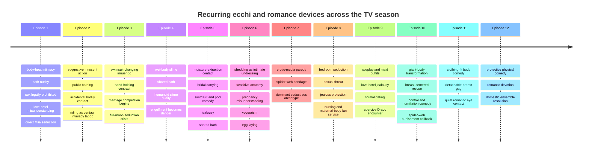

# *Monster Musume: Everyday Life with Monster Girls* — Anime-Only Episode and Ecchi-Mechanics Analysis

## Executive summary

The twelve-episode television series *Monster Musume: Everyday Life with Monster Girls* aired from July through September 2015. Its basic dramatic engine is remarkably consistent: Kimihito Kurusu attempts to conduct an ordinary domestic or social activity with one or more liminal housemates, a species-specific biological or cultural complication turns that activity intimate or embarrassing, the situation escalates through misunderstanding and jealousy, and the episode eventually converts the sexual tension into physical comedy, danger, or a character-development beat. citeturn17search22turn22search25

The series is consequently more useful as a writing study when its ecchi material is treated as **story machinery**, rather than as a collection of isolated fan-service shots. Its strongest recurring technique is to make erotic comedy arise from something that could only happen with that particular kind of monster girl. Miia's snake physiology produces constriction, shedding, heat and mating jokes; Papi's avian physiology produces wing-related clothing problems and egg-laying jokes; Centorea's centaur body turns riding, clothing and human physical intimacy into cultural taboos; Suu's liquid body turns bathing, hydration and bodily contact into eroticized slapstick; Mero's aquatic physiology makes carrying, swimming and bathing intimate; Rachnera's silk and anatomy become bondage imagery; and Zombina's detachable body turns otherwise grotesque slapstick into provocative teasing. This species-specific approach is repeatedly identified even by contemporary viewer analysis as the element distinguishing the series from generic accidental-pervert comedy. citeturn28search4turn27search32turn18search8

The other major engine is **institutional prohibition**. The interspecies exchange rules initially prohibit sexual relations and tightly regulate liminals' freedom of movement. This creates a built-in "they want to, but legally cannot" structure. Episode three then reverses the pressure by making Kimihito a prospective interspecies-marriage test case, converting prohibition into romantic competition. From that point on, Miia, Papi, Centorea and the later residents are no longer merely cohabitants: the possibility of marriage makes ordinary domestic interactions function as auditions for intimacy. citeturn3view0turn28search4turn22search25

The overall ecchi profile is not uniform. Episodes three, four, six, eight and ten are the most concentrated examples of species-based sexual comedy. Episodes seven, nine and eleven use sexuality more as character characterization, danger, costume comedy or fetish coding. Episode twelve deliberately lowers the erotic intensity and closes on ensemble domestic comedy. citeturn25view3turn28search9turn25view4turn25view5turn17search0turn27search30

There is also an important tonal distinction between **consensual/flirtatious fan service** and scenes involving coercion. The full-moon pursuit of Kimihito in episode three, Kasegi's invasive filming and touching in episode six, the attempted assault on Centorea in episode eight, and Draco's behavior toward Miia in episode nine should not all be classified merely as "sexy comedy." The anime sometimes packages coercive behavior inside comic or sensational staging, but narratively these moments involve compromised consent or outright threat. citeturn25view3turn27search30turn17search0turn18search0

For an original light novel, the most transferable lesson is therefore not "copy the monster-girl situations." It is:

> **Give each supernatural heroine a nonhuman biological or cultural rule, introduce that rule through an ordinary problem, allow it to produce intimacy naturally, let competing characters misinterpret what they see, escalate the consequence beyond sexuality, and resolve the sequence with a piece of characterization.**

That structural formula can be reused while replacing every specific species, body mechanic, legal framework, character archetype, signature joke and scene discussed below.

## Scope, timing method, and censorship baseline

This analysis covers **only the twelve television episodes**. Manga material, OVAs and later source developments are excluded from the evidentiary analysis.

The minute markers below are **scene-navigation markers rather than frame-accurate timecodes**. Episode masters are roughly television-length, and exact positions can move because of platform bumpers, alternate credit handling, localized masters and whether the opening is automatically skipped. Where timed English subtitle material is available, it provides unusually precise anchors. For example, episode one's opening Miia sequence begins around 00:17, its bath sequence around 04:33, and Smith's discussion of prohibited sexual activity around 07:38; episode four's subtitle timing similarly places Centorea's slime-covered state around 04:23, the bath entrance around 05:11, Suu's humanoid transformation around 08:08 and Kimihito's escape around 10:14. citeturn3view0turn28search9

For episodes where equivalent timed transcript material was not independently recoverable, I use deliberately broad ranges such as **~03:00–06:00** instead of presenting invented second-level precision. Rachnera's documented screen-time breakdown is useful for several later episodes, including approximately 12:53 onward in episode seven, 01:52–11:21 through much of episode eight, 09:16–11:15 in episode nine, and several sequences through episodes ten to twelve. citeturn17search11

### How "fan service event" is counted

An **event** here means a discrete sequence in which the script, acting, editing, costume or camera deliberately creates sexual suggestion, body emphasis or romantic embarrassment. A single sequence containing ten cleavage reaction shots is treated as one extended event rather than ten unrelated events. Neutral shots of a character whose standard costume is revealing are not repeatedly counted unless the cinematography specifically emphasizes that feature.

The inventory distinguishes:

**Nudity / concealment:** bathing, exposed breasts, absence of underwear, clothing displacement, strategically hidden anatomy.

**Accidental intimacy:** collisions, carrying, touching, compromising positions, accidental viewing.

**Deliberate sexual advance:** seduction, invitations, deliberate provocative contact or attempts to escalate intimacy.

**Species fetishization:** a biological or cultural trait used explicitly as an erotic mechanism.

**Harem competition:** jealousy, mate-selection behavior, interruption, status competition.

**Visual fan service:** cleavage inserts, body pans, low or body-part-centered framing, revealing costumes, deliberately suggestive compositions.

**Sexualized threat:** coercive or non-consensual situations. This category is separated from ordinary fan service because narratively they function differently.

For youthful-presenting characters, the discussion stays categorical rather than dwelling on sexualized visual detail.

### Censorship

There is no single answer to "is *Monster Musume* censored?" because release masters differ. A direct HDTV-versus-Blu-ray frame comparison of episode one documents shots in which the television presentation concealed nipple detail through reframing, overlays, foreground obstruction or alternate positioning while the Blu-ray displayed more explicit breast detail. It also documents changed framing rather than only stereotypical white light or steam. citeturn2search29

Accordingly, the episode notes use three different terms:

| Label | Meaning |
|---|---|
| **Visible concealment** | The composition itself hides explicit anatomy through steam, slime, clothing, limbs, crops, props or camera position. |
| **TV/BD difference confirmed** | I found direct comparison evidence for that episode. |
| **BD restoration unverified here** | The television scene is clearly composed around concealment, but I do not claim a particular Blu-ray alteration without episode-specific evidence. |

The series frequently makes the censoring device part of the joke. Slime, tails, hair, bath steam, swimsuits, foreground objects and characters' limbs can simultaneously preserve broadcast modesty and draw greater attention to whatever is being hidden. Episode one is the clearest directly verified example of broadcast framing being altered for later home-video presentation. citeturn2search29

## Episode-by-episode analytical report

### Species One: *Everyday Life with a Lamia*

Episode one establishes virtually the entire grammar that the remaining series will remix: forced domestic proximity, nonhuman physiology, legal sexual prohibition, voyeuristic embarrassment, public prejudice, romantic rescue and an attempted seduction interrupted before consummation. The timed subtitle record is especially useful for this episode. citeturn3view0turn12search3

| Approx. time | Plot progression | Ecchi, sexual and fan-service inventory |
|---|---|---|
| **00:17–02:20** | Kimihito awakens with Miia in his bed and physically wrapped around him. Her cold-blooded physiology motivates her seeking his warmth. His effort to escape becomes the opening slapstick set piece. | **Bed-sharing/body heat trope.** Miia presses herself against him while coiling around him. Kimihito becomes acutely aware of her breasts. Contact with the sensitive tip of her tail produces an exaggerated sexual-reaction gag. The animation turns a biological fact, cold-blooded thermoregulation, into intimate body contact. The camera emphasizes proximity and Miia's upper body. citeturn3view0 |
| **~02:20–04:30** | Household routine and the basic host/guest relationship are established. | Even nonsexual domestic blocking keeps Miia physically close to Kimihito, establishing clinginess as her default romantic language rather than reserving touch for isolated "special" scenes. citeturn3view0 |
| **04:33–~06:00** | Kimihito encounters Miia during bathing. Miia notices him looking and attempts to convert the accident into mixed bathing. He resists and ultimately uses cold water to defuse the situation. | **Bath nudity; accidental viewing; deliberate seduction; mixed-bath invitation.** The scene combines exposed-body embarrassment with Miia actively trying to bring Kimihito into the bath. Her body is framed as both erotic object and physical hazard. The television master uses strategic framing/concealment; episode-one Blu-ray comparisons document restored breast detail in several shots. citeturn3view0turn2search29 |
| **~06:30–09:45** | Ms. Smith arrives and explains or reinforces the rules governing interspecies homestays. The key point is that sexual relations between human hosts and exchange participants are forbidden. Smith directly questions whether Kimihito and Miia have had sex. | **Sex as legal taboo.** Rather than an accidental gag, the dialogue explicitly establishes intercourse as the prohibited destination toward which Miia's advances are tending. Smith teases both of them about attraction and physical compatibility, creating bureaucratic sexual comedy. Miia becomes jealous/defensive when Smith discusses her body and relationship. citeturn3view0 |
| **~10:10–12:30** | Miia emotionally reacts to the prohibition and tries to persuade Kimihito that she is willing to accept the consequences. Her attempt at intimacy becomes physically dangerous because of her strength, contributing to Kimihito's injured shoulder. | **Direct seduction plus "monster strength makes sex dangerous."** This becomes a recurring series rule: desire itself is not Kimihito's only obstacle; the heroine's anatomy can literally injure him. The joke therefore combines virgin-protagonist restraint, legal prohibition and physical peril. citeturn3view0turn12search3 |
| **~12:30–17:30** | Kimihito accompanies Miia into town. The outing exposes practical problems of living publicly as a liminal, including clothing and unwanted attention. | An **all-species lingerie/clothing sequence** lets the anime display how human clothing does and does not map onto a lamia body. It is simultaneously worldbuilding and lingerie fan service. Public staring also makes Miia's body an in-universe spectacle, not merely a camera spectacle. citeturn12search3 |
| **~17:30–20:30** | To escape attention and harassment, Kimihito and Miia wind up hiding in a love hotel. A social-media report brings the authorities/security detail to the location. | **Love-hotel misunderstanding trope.** The setting itself implies sex even before anyone acts. Because sex is legally forbidden, merely being discovered there creates a scandal. This is a good example of an erotic setting performing narrative work without consummation. citeturn12search3 |
| **~20:30–22:00** | The prejudiced couple encountered earlier harasses Miia. Kimihito protects her and punches the aggressor despite the legal danger to himself. | The sequence stops using sexuality for comedy and converts Kimihito's willingness to endure consequences into romantic validation. This is crucial to the series' formula: the protagonist earns the heroine's intensified attraction through decency rather than through successful seduction. citeturn12search3 |
| **~22:00–end** | Back home, Miia interprets the day's emotional closeness as another opportunity to advance physically. Smith interrupts. | **Interrupted seduction / status-quo reset.** The episode closes by returning to its opening conflict, signaling that almost every romantic victory will produce a new ecchi escalation rather than immediate relationship resolution. citeturn12search3 |

**Censorship assessment:** **High confidence.** Episode one has directly documented TV/BD visual differences. Television framing conceals explicit breast detail in places through cropping, overlays, fabric or repositioning; Blu-ray footage restores some of that detail. citeturn2search29

**Writing function:** The important construction is **biology → intimacy → legal obstacle → emotional proof → renewed desire**. The fan service is therefore attached to the episode's entire character arc rather than inserted independently.

### Species Two: *Everyday Life with a Harpy and Centaur*

Episode two uses a paired-introduction structure. Papi's half emphasizes innocence, nudity and bodily comedy, while Centorea's half sexualizes dignity, chivalry and culturally loaded physical contact. citeturn23search9turn22search25

| Approx. time | Plot progression | Ecchi, sexual and fan-service inventory |
|---|---|---|
| **~00:00–03:30** | Papi effectively carries Kimihito away and spends time with him outside, behaving impulsively and treating the excursion as play. | Her physical handling of Kimihito reverses the usual male-carries-female romance image. The intimacy is not initially seductive, which makes later suggestive framing more incongruous. citeturn22search25 |
| **~03:30–06:00** | Kimihito buys Papi ice cream. | The eating sequence is deliberately staged as **sexual visual innuendo**, a point repeatedly singled out by viewers discussing the episode. It is a classic ecchi technique: an innocent activity is shot so the viewer supplies the adult interpretation. Because Papi has a youthful presentation, the analytical takeaway is simply the use of suggestive object/action substitution rather than the visual specifics. citeturn25view0 |
| **~05:30–08:00** | Papi cools herself in a public fountain. Miia catches up with the pair. | **Public bathing/nudity and exposure comedy.** Papi's casual attitude toward undress clashes with human social conventions. Strategic framing prevents explicit genital detail. Miia's arrival adds jealousy to what Papi sees as innocent behavior. citeturn22search25 |
| **~07:30–10:30** | A child becomes stuck in a tree; Papi and Miia become involved in the rescue. Police attention follows because Papi is outside without a proper host. | The ecchi emphasis falls away during the rescue, allowing Papi's introduction to establish kindness rather than leaving her as a collection of sexual gags. Kimihito protects her administratively by presenting himself as her host. citeturn22search25 |
| **~10:30–12:00** | Smith regularizes the arrangement and Papi becomes another resident. | **Harem expansion.** Miia's exclusive domestic fantasy is now structurally impossible. Each additional resident increases interruption probability and jealousy opportunities. citeturn22search25 |
| **~12:00–14:30** | While shopping, Kimihito collides with Centorea. A purse-snatching incident immediately pushes them into action together. | The collision and recovery use **accidental close-contact comedy** and bust-emphasizing composition. Centorea's very large human torso atop a horse body gives the camera an easy contrast between dignified speech and exaggerated physical design. citeturn22search25turn25view0 |
| **~14:30–19:00** | Kimihito participates in the chase, eventually riding Centorea. Their attempt to stop the thief produces repeated embarrassing mishaps, and Kimihito takes what he believes is a sword attack while protecting her. | **Riding as sexualized species taboo.** What is ordinary transportation for a horse becomes culturally intimate for Centorea. The action sequence also uses accidental bodily proximity while the protagonist is trying to do something heroic, letting action and fan service occupy the same sequence. citeturn22search25turn25view0 |
| **~19:00–22:00** | Smith explains the significance of allowing a person to ride a centaur. Centorea, moved by Kimihito's self-sacrifice, formally chooses him as her master and joins the household. | The anime explicitly assigns quasi-sexual meaning to **mounting/riding**, turning a nonhuman cultural rule into a chastity/intimacy metaphor. Centorea's embarrassment establishes a contrast that remains central to her characterization: physically imposing and highly sexualized in design, but romantically formal and easily flustered. citeturn25view0turn22search25 |

**Censorship assessment:** Papi's fountain sequence uses visible compositional concealment. Centorea's scenes depend more on cleavage, contact and framing than full nudity. **No episode-specific Blu-ray alteration is asserted here.**

**Writing function:** Episode two demonstrates a useful two-part design: introduce one heroine through **casual bodily openness**, the other through **a highly specific cultural intimacy rule**. Both lead to the same result, a new resident, but neither feels like a duplicate introduction.

### Species Three: *Everyday Life Under Dangerous Circumstances*

Episode three is the television season's clearest transition from "cohabitation ecchi" to an actual harem-romance premise. Its first half rehearses jealousy and intimate accidents; the marriage announcement then converts all three heroines' attraction into explicit competition, and the full moon removes their normal restraint. citeturn28search4turn22search25

| Approx. time | Plot progression | Ecchi, sexual and fan-service inventory |
|---|---|---|
| **~00:00–03:00** | Miia and Centorea argue over status and Kimihito's attention while household rules are being reviewed. Kimihito accidentally encounters Centorea bathing. | **Accidental nude encounter**, followed immediately by Miia's jealousy. The anime turns each heroine's previous intimate accident into competitive evidence, with Miia invoking her own relationship and Centorea emphasizing Kimihito's heroism. citeturn28search4 |
| **~03:00–06:30** | Papi wants to bathe. Kimihito must help her into a school swimsuit because her wings make ordinary dressing difficult. | The dressing scene is constructed around **double-entendre dialogue** about holes, insertion and tightness even though the literal task is putting on a swimsuit. Kimihito accidentally touches her chest while helping. Papi then attempts to turn the bodily reaction into further intimacy; Centorea intervenes. citeturn28search4 |
| **~06:30–09:30** | Centorea takes Kimihito away to the park. He encourages her to experience ordinary human leisure instead of acting only as a knight. She shyly asks to hold hands. | The erotic register deliberately drops to **hand-holding as major intimacy**. This contrast is important: after far more revealing fan service, Centorea is more emotionally destabilized by ordinary romantic contact. The preceding ride also produces embarrassing lingering physical proximity. citeturn28search4 |
| **~09:30–11:30** | Miia and Papi find them and jealousy erupts into a fight. Smith attempts to tranquilize the monster girls but accidentally hits Kimihito. | **Harem jealousy becomes slapstick violence.** Competition itself is now the recurring source of danger. citeturn28search4turn22search25 |
| **~11:30–14:00** | After Kimihito recovers, Smith announces a proposed legal change allowing human-liminal marriage and designates his household as a potential test case. | **Marriage stakes formally activate the harem.** Sexual frustration is no longer only about prohibited sex; each heroine can imagine becoming the legitimate partner. Kimihito's lack of romantic experience becomes part of the joke. citeturn28search4 |
| **~14:00–16:30** | That night Miia comes to Kimihito's room. The full moon has intensified liminal instincts. She describes snake mating behavior while wrapping herself around him and makes a direct attempt to consummate their relationship. | **Most direct Miia seduction of the TV season to this point.** Species-specific mating behavior, coiling, missing underwear and marriage talk are combined. The danger comes from the fact that Miia's constriction strength rises with emotional intensity. citeturn28search4turn25view3 |
| **~16:30–18:00** | Papi interrupts and is similarly affected. She interprets marriage in reproductive terms and joins the pursuit. | **Reproductive/egg-laying innuendo** replaces Miia's snake-mating imagery. The series thus gives the same "overcome by instinct" premise a species-specific expression. citeturn28search4 |
| **~18:00–20:00** | Centorea arrives apparently to rescue Kimihito but is affected as well and openly offers herself to him. The three compete for physical access to him while failing to control their strength. | **Three-way seduction becomes survival comedy.** The humor explicitly depends on Kimihito realizing that sex or even affectionate physical contact under these conditions could seriously injure him. This is also a compromised-consent sequence because the girls' behavior is chemically/instinctively altered and Kimihito is fleeing. citeturn28search4turn25view3 |
| **~19:30–20:30** | Kimihito phones Smith for help; Smith herself is bathing and eventually drops her phone. | **Brief Smith bath fan service**, juxtaposed against her detached bureaucratic advice while Kimihito is in danger. A recurring secondary trope is that the supposedly responsible human official is herself casually sexualized. citeturn28search4turn25view3 |
| **~20:00–21:30** | Kimihito uses an accidental ketchup spill that looks like blood to shock the girls out of their pursuit. | Erotic escalation is terminated by simulated injury. This is a classic *Monster Musume* reset: bodily danger overwhelms libido because the girls genuinely care about him. citeturn28search4 |
| **~21:30–end** | The girls remember little or nothing the next morning. Kimihito accepts responsibility for having avoided the marriage question and resolves to date all three as prospective partners. | The harem receives an explicit narrative justification. His answer avoids choosing anyone, preserving the ensemble while making future jealousy narratively legitimate. citeturn22search25turn28search4 |

**Censorship assessment:** Multiple scenes use bath framing, hair/body placement and strategic composition. Miia's lack of underwear is conveyed without genital depiction. Smith's bath is likewise compositionally concealed. **Episode-specific BD restoration not independently verified here.**

**Writing function:** This episode illustrates the escalation pattern **minor intimate accident → sweet romance → institutional plot twist → biologically amplified sexual crisis → status-quo-expanding resolution**.

### Species Four: *Everyday Life with a Slime*

Episode four may be the purest example of turning an alien body mechanic into fan service. Suu does not begin as a conventional romantic rival. Instead, the erotic staging emerges from the properties of a water-based body and from her tendency to imitate what she observes. Timed subtitles give strong anchors for the first half. citeturn28search9turn27search30

| Approx. time | Plot progression | Ecchi, sexual and fan-service inventory |
|---|---|---|
| **~00:00–03:00** | A mysterious slime appears in the kitchen. Centorea explains that some liminal species remain legally unrecognized. | The setup itself is initially nonsexual, which matters because the later eroticization is motivated by the creature's physical rules rather than by an immediate seductress introduction. citeturn28search9 |
| **03:51–04:35** | Centorea attacks the slime unsuccessfully. Both she and Kimihito are coated in slime. | **Wet-body/slime coating fan service.** At about 04:23 Centorea remarks that her entire body is slimy. The liquid allows contour emphasis while remaining an in-story substance rather than clothing removal. Kimihito abruptly retreats to wash. citeturn28search9 |
| **~04:42–07:20** | Kimihito enters the bath/shower. Centorea, unable to remove the slime properly, asks to join him. They attempt to clean themselves while discussing why the slime is seeking water. | **Shared bath, nudity and washing.** Centorea's formal embarrassment contrasts with practical necessity. The intimacy is framed as a logical consequence of the monster problem. Steam, crops and body positioning provide visible concealment. citeturn28search9turn27search30 |
| **07:34–08:10** | The slime enters the bathroom and knocks Centorea out of commission. | The scene converts ordinary bath fan service into a creature encounter. The slime's intrusion removes the social boundaries that Centorea and Kimihito were still observing. citeturn28search9 |
| **08:08–~10:15** | Suu takes on a humanoid female form, apparently imitating what she has observed. She imitates washing Kimihito but, because her body is liquid, begins enveloping and absorbing him. He nearly loses consciousness before escaping by diluting her with bathwater. | **Humanoid nude slime form; exaggerated breasts; intimate washing; full-body engulfment.** The scene deliberately oscillates between erotic visual coding and suffocation danger. The subtitle dialogue even has Kimihito register the size of the humanoid form's breasts afterward. This is species fetishization in its clearest form: an erotic action is simultaneously a lethal misunderstanding caused by alien physiology. citeturn28search9turn27search30 |
| **~10:15–13:00** | The household debates what to do with the slime. Papi names her Suu. They realize a conventional naked humanoid appearance is impractical and give her a raincoat. | The dialogue explicitly notes Suu cannot remain naked. The raincoat is selected because it will not absorb water or become transparent, making clothing logistics themselves part of the fan-service worldbuilding. citeturn28search9 |
| **~13:00–16:00** | The residents worry that Suu's unrecognized legal status means authorities could remove her. Papi misunderstands and flees with Suu. | Sexual content largely pauses. The tonal shift gives Suu emotional stakes and keeps the episode from making her only a slime fetish device. citeturn27search30 |
| **~16:00–21:30** | Kimihito catches them at a park. Papi's child friends appear. A runaway truck endangers one of them; Suu saves the child but falls toward the water, which could dissolve her. Kimihito improvises a rescue with the crashed vehicle. | Little conventional fan service. Instead the same **water vulnerability** that generated the bath ecchi is repurposed as dramatic peril, a particularly strong piece of structural reuse. citeturn27search30 |
| **~21:30–end** | Kimihito decides Suu can remain. They return to find Smith waiting. | Harem expansion occurs through compassion rather than romantic conquest. citeturn27search30 |

**Censorship assessment:** **Heavy visible concealment**, but much of it is diegetic. Suu's translucent/slime body, bathwater, steam and framing cover explicit anatomy. Centorea's shared-bath material similarly uses bath composition. No episode-specific BD change is claimed.

**Writing function:** This is an outstanding example of **one fantasy rule serving three functions**: sexual comedy, practical worldbuilding and later life-or-death drama.

### Species Five: *Everyday Life with a Mermaid*

Episode five first extends Suu's hydration mechanic into repeated physical assaults on the existing heroines, then introduces Mero through romantic rescue and mobility dependency. It finishes by contrasting Miia's possessive romance with Mero's idealization of tragic love. citeturn27search30turn8search3

| Approx. time | Plot progression | Ecchi, sexual and fan-service inventory |
|---|---|---|
| **~00:00–03:30** | Smith's security personnel arrive to alter the house. Believing Suu may be discovered, the girls sneak her outside and accidentally leave Kimihito behind. | The immediate engine is secrecy rather than sexuality, but separating Kimihito from the group allows Suu's behavior to be directed at the women without the usual male-protagonist focal point. citeturn27search30 |
| **~03:30–07:00** | Miia, Centorea and Papi successively become wet or provide moisture cues. The dehydrated Suu attacks them to replenish herself. | **Moisture extraction as sexualized physical comedy.** Suu clings to bodies and draws water from them while the victims' reactions and the camera make the encounters conspicuously suggestive. Contemporary episode commentary specifically treated these attacks as among the episode's most "lewd" sequences. The important distinction is that the contact is non-consensual even though presented comedically. citeturn27search30turn8search3 |
| **~07:00–10:30** | Kimihito searches for the others and is struck by a runaway wheelchair. He meets Mero and helps her. | **Meet-cute through rescue and physical dependency.** Unlike Miia or Papi, Mero's intimacy begins because she cannot move effectively on land without assistance. Her aquatic body turns ordinary helping behavior into sustained bodily proximity. citeturn27search30 |
| **~10:30–13:00** | The groups reunite. Suu also targets Mero, but Kimihito catches or contains Suu before she can complete the attack. Smith reveals that the home's construction is not primarily for Suu but for Mero, who is joining them. | Mero's reveal foregrounds her mermaid body and specialized swimwear. The scene adds another highly distinctive silhouette to the harem and immediately provokes Miia's concern. citeturn27search30 |
| **~13:00–16:30** | Kimihito accidentally breaks Mero's wheelchair and therefore carries her through the house. | **Bridal-carry trope amplified by physiology.** What might be a momentary romantic pose with a human heroine becomes prolonged because a mermaid genuinely cannot walk. Mero's body and swimsuit remain physically close to Kimihito throughout, while Miia reads the practical assistance as courtship. citeturn27search30turn29search0 |
| **~16:30–19:30** | Near the newly built pool, Suu again becomes a danger. Kimihito pushes/throws Mero into the water to protect her. Miia misreads the situation, dives in and becomes dangerously sluggish because of the cold. | **Swimsuit/pool fan service plus jealousy misinterpretation.** Mero is visually at home in an environment that turns Miia physically vulnerable. The scene converts the standard ecchi pool setting into a species-comparison problem. citeturn27search30turn8search3 |
| **~19:30–22:00** | Miia and Mero share a bath and finally talk honestly. Mero explains that she does not intend to steal Kimihito in the straightforward way Miia fears; she romanticizes tragic, impossible love. | **Female shared-bath fan service** is used for relationship clarification rather than male voyeurism. Bare bodies, steam and close composition accompany a surprisingly substantive discussion of competing romance ideologies. citeturn27search30 |
| **~22:00–end** | Centorea and Papi overhear only part of the conversation and misinterpret what Miia and Mero are saying. | **Eavesdropping misunderstanding trope.** The resolution of one jealousy conflict immediately plants another. citeturn27search30 |

**Censorship assessment:** Pool/swimsuit material is mostly covered by costume. The bath uses steam, framing and body placement. Suu's liquid form itself prevents conventional explicit anatomy. **BD restoration not independently verified.**

**Writing function:** Episode five demonstrates that **mobility limitations can produce romantic proximity without contriving accidental falls**, while an existing heroine's jealousy supplies the comedy.

### Species Six: *Everyday Life with Shedding and Egg Laying*

This is one of the densest ecchi episodes because both halves begin with real nonhuman biological processes and deliberately reinterpret them through erotic visual language. The second half then introduces a predatory filmmaker, making voyeurism itself part of the plot rather than leaving the audience's gaze unexamined. citeturn27search30turn17search24turn25view4

| Approx. time | Plot progression | Ecchi, sexual and fan-service inventory |
|---|---|---|
| **~00:00–02:30** | Miia tries to improve her domestic usefulness by cooking and burns her hands. Kimihito treats and bandages them. | **Caretaking intimacy.** Physical tenderness starts innocently. Miia's desire to be a competent future partner ties cooking directly to the marriage competition. citeturn27search30turn17search24 |
| **~02:30–07:30** | Kimihito discovers Miia is shedding and cannot remove her skin properly because of her injured hands. He agrees to help. | **Shedding as stripping metaphor.** Kimihito manually assists with skin removal along Miia's body. The direction uses tension, embarrassment and Miia's reactions to make an essentially reptilian biological process resemble intimate undressing or massage. citeturn17search24turn25view4 |
| **~05:00–07:30** | While helping along her lower body, Kimihito touches an unusually sensitive area. Miia reflexively reacts violently enough to knock him out. | **Monster-specific erogenous-zone gag.** The sequence directly links unfamiliar anatomy, accidental touch, sexual reaction and physical danger. This is one of the series' signature structures. citeturn27search30turn17search24 |
| **~07:30–10:00** | Miia tries to apologize by making dinner but fails because she ignored proper instructions. | The sexual tension collapses into domestic-comedy failure. This prevents the shedding scene from becoming a relationship breakthrough and restores the ensemble status quo. citeturn27search30 |
| **~10:00–12:00** | Papi announces that she is about to lay an egg. The household initially interprets this as pregnancy before learning the egg is unfertilized. | **Pregnancy/reproduction misunderstanding.** The joke works because avian reproduction makes a statement that would imply sex in a human household completely normal for Papi. citeturn27search30turn25view4 |
| **~12:00–17:00** | Filmmaker Kasegi appears claiming to be documenting interspecies life. He repeatedly behaves invasively. | This becomes a concentrated inventory of **voyeurism and harassment**: he films Mero during a swimsuit slip, touches Centorea after learning she does not wear a bra, and takes Miia's shed skin. The camera-within-the-camera device turns the episode's sexualized gaze into an antagonistic character trait. citeturn27search30 |
| **~17:00–20:30** | Papi begins laying the egg. Kasegi wants footage and the physical egg for exploitative/profitable reasons. Kimihito assists Papi while Suu reads Kasegi's intentions. | **Egg-laying staged as labor/reproductive fetish material.** Breathing, bodily exertion, camera intrusion and Kasegi's excitement deliberately eroticize the process. Viewer discussion at the time singled out both Miia's shedding and Papi's egg-laying as the episode's most overt material. citeturn25view4turn27search30 |
| **~20:30–21:30** | Kimihito tricks Kasegi with an ordinary store egg and punches him. Papi successfully lays her egg in relative privacy. | Kimihito's role is again protector rather than sexual opportunist. His restraint is what makes the heroines trust him despite the show's constant sexual situations. citeturn27search30 |
| **~21:30–22:30** | Papi stores the egg in the refrigerator. Miia later accidentally cooks it. | **Reproductive anticlimax.** Something treated minutes earlier as intimate and precious becomes an absurd kitchen accident. citeturn27search30 |
| **Tag** | Kasegi encounters Rachnera and complains about her webs; she binds him and becomes interested in Kimihito. | First use of **arachne bondage imagery**, setting up the next episode's dominant/submissive coding. citeturn27search30 |

**Censorship assessment:** **Heavy visible concealment.** The shedding sequence uses framing/body placement; Mero's wardrobe displacement is presented without sustained explicit exposure; egg-laying is framed so reproductive anatomy is not shown. Kasegi's camera angles are deliberately voyeuristic. **Specific TV-to-BD changes were not independently verified for this episode.**

**Writing function:** Episode six shows how to write ecchi from **biology rather than coincidence**. The two major sexual set pieces would not function identically if Miia and Papi were ordinary humans.

### Species Seven: *Everyday Life with MON and an Arachne*

Episode seven deliberately shifts genres. Its first half is essentially a tactical hostage comedy that introduces MON, while its second half turns Rachnera's kidnapping of Kimihito into bondage-coded character introduction. citeturn27search30turn17search0

| Approx. time | Plot progression | Ecchi, sexual and fan-service inventory |
|---|---|---|
| **~00:00–03:00** | An orc organization occupies a dōjinshi store and takes hostages. Their stated grievance concerns insufficient erotic depiction of orcs. | **Pornographic-media parody.** Sexuality is the motive for the hostage gag rather than something happening between the protagonists. The joke depends on an absurd mismatch between violent tactical stakes and a demand concerning erotic manga representation. citeturn27search30 |
| **~03:00–09:00** | Police are constrained by legal loopholes. Smith deploys MON. Zombina apparently gets shot; Manako snipes weapons from afar; Tionishia breaches; Doppel is revealed as an infiltrator. | MON's designs retain the series' body-conscious visual style, but the sequence is primarily action comedy. The female tactical team broadens the show's archetype pool beyond "prospective brides." citeturn27search30 |
| **~09:00–12:30** | MON resolves the hostage situation. | Minimal direct ecchi beyond costume/body-design baseline and the erotic-manga premise. citeturn27search30 |
| **~12:50–14:40** | Kasegi is found wrapped in webbing; the arachne responsible has escaped. Smith and the household realize Kimihito has also disappeared. | **Web bondage motif** shifts from punitive gag against Kasegi to a real threat involving Kimihito. Rachnera's costume itself is designed around her habit of hanging inverted, emphasizing exposed lower/under-bust geometry. Contemporary episode discussion explicitly noticed the inverted-costume joke. citeturn17search11turn27search6 |
| **~14:40–20:30** | Kimihito awakens in a deserted warehouse, bound in webbing and hanging upside down. Rachnera introduces herself and deliberately intimidates/teases him. | **Bondage, captivity and dominant-seductress coding.** Web restraint replaces the usual accidental contact. Rachnera tests whether Kimihito will recoil from her spider anatomy, so body display is tied to insecurity as well as sexual provocation. citeturn17search0turn17search11 |
| **~20:30–22:00** | Smith, MON and police arrive. Kimihito initially assumes they are pursuing him because he punched Kasegi and urges Rachnera to escape. She recognizes that his acceptance of her appearance is genuine. | Sexual dominance gives way to emotional vulnerability. Kimihito "wins" Rachnera not by overpowering or reciprocating the bondage scenario but by refusing to treat her nonhuman lower body as disgusting. citeturn17search0turn27search30 |
| **~22:00–end** | Smith arranges for Rachnera to move into the household. | **Harem expansion through aggressive flirt archetype.** Rachnera adds a woman who is far more comfortable deliberately creating compromising situations than Miia or Centorea. citeturn17search0 |

**Censorship assessment:** Low-to-moderate. Rachnera's revealing costume and body angles provide fan service, but the major sequence is bondage while clothed rather than explicit nudity. No substantial censor device is required beyond costume/framing.

**Writing function:** A useful ensemble strategy is demonstrated here: when the existing romantic cast already covers "clingy," "innocent," "formal" and "idealistic," introduce a new character whose **sexual confidence changes the behavior of the existing cast**, rather than simply adding another jealous admirer.

### Species Eight: *Everyday Life in Poor Health*

Episode eight gives Rachnera immediate narrative utility by forcing Centorea to confront her prejudice, then pivots into a nursing episode where Suu's mutable physiology produces the climactic fan-service beat. citeturn17search0turn25view5

| Approx. time | Plot progression | Ecchi, sexual and fan-service inventory |
|---|---|---|
| **~01:50–04:30** | Rachnera settles into the house. Miia and Centorea distrust her. Centorea stays unusually close to Kimihito to stop Rachnera from creating compromising situations. | **Protective clinging becomes accidental fan service.** Centorea's attempt to prevent sexual contact requires constant physical proximity to the man she is supposedly protecting. Jealousy masquerades as security. citeturn17search0turn17search11 |
| **~04:30–06:30** | Rachnera corners Kimihito in his bedroom and openly tries to seduce him. Centorea intervenes and removes him from the house. | **Direct bedroom seduction.** Rachnera differs from the earlier heroines because there is almost no innocent misunderstanding. She intentionally manipulates proximity and embarrassment. Viewer discussion singled this out as one of her defining seductive moments. citeturn25view5 |
| **~06:30–10:30** | Away from the house, Centorea and Kimihito encounter human men who harass her and escalate toward sexual assault. Rachnera intervenes and restrains them. | This is **sexual threat, not ordinary fan service**. Any torn-clothing/compromising imagery exists inside a coercive scene. Its story purpose is to expose the hypocrisy in Centorea judging Rachnera by appearance while human attackers behave monstrously. Rachnera's web restraint then reverses the power relation. citeturn17search0 |
| **~10:30–11:30** | Centorea accepts Rachnera more fully after the rescue. | Rachnera's fetish-coded power is reframed as protective rather than inherently predatory. citeturn17search0 |
| **~11:30–14:00** | Kimihito develops a severe cold. Smith attempts quarantine, and the girls are prevented from personally nursing him. | **Nursing/bedside-intimacy setup.** Each heroine's desire to care for him is implicitly romantic, but quarantine blocks the straightforward version of the trope. citeturn17search0 |
| **~14:00–19:30** | Suu can safely move between rooms and becomes the household's intermediary. The others try to instruct her how to care for Kimihito. Suu learns he became ill partly because he searched for her in bad weather. | The sequence builds **caretaker intimacy** through mimicry. Suu absorbs instructions and emotions, letting multiple heroines' nurturing impulses be funneled into one body. citeturn17search0 |
| **~19:30–21:30** | Suu modifies her body into a more mature/maternal form and feeds Kimihito restorative fluid in a breastfeeding-coded sequence. He improves. | **Species-specific maternal/breastfeeding fan service.** It combines nursing, bodily transformation, chest emphasis and Suu's fluid biology. Viewer commentary identifies this as the episode's standout sexualized sequence. citeturn25view5turn27search32 |
| **~21:30–end** | Smith catches the cold herself. MON members are far less enthusiastic about nursing her. | A sex-comedy sequence ends with a mundane reversal, again using anticlimax as reset. citeturn17search0 |

**Censorship assessment:** Rachnera's seduction uses revealing costume and composition rather than full nudity. Suu's body transformation is naturally obscured by her nonhuman material and by framing. No episode-specific BD restoration is asserted.

**Writing function:** The strongest trick here is **reuse with changed emotional meaning**. Suu's fluid body was dangerous and invasive in earlier episodes; here the same capacity becomes nurturing.

### Species Nine: *Everyday Life with Threatening Letters*

Episode nine converts the whole harem into a surveillance comedy. Costumes and a love-hotel fake-out dominate the first half; the second half gives Miia an actual date, only to have jealousy and Draco's predatory behavior derail it. citeturn18search0turn23search8

| Approx. time | Plot progression | Ecchi, sexual and fan-service inventory |
|---|---|---|
| **~00:00–03:00** | Kimihito leaves for what appears to be a date with Smith. The housemates immediately become suspicious and begin following them. | **Jealous-stalking harem trope.** Smith, previously the regulator of everyone else's sexual behavior, is temporarily positioned as a romantic rival. citeturn18search0 |
| **~03:00–09:00** | The pursuers use disguises to remain close: Mero blends into a maid café, Papi uses cosplay logic, and Miia/Centorea impersonate service workers. Suu assists with disguises. | **Cosplay/maid-service fan service.** The erotic charge comes from costume archetypes rather than nudity. The comedy also repeatedly exposes how terrible the heroines are at disguising their unusual bodies. citeturn18search0 |
| **~09:00–11:30** | Smith takes Kimihito into a love hotel. Miia and Rachnera attempt to investigate, only to be intercepted by MON. | **Love-hotel panic, jealousy and voyeuristic pursuit.** The same location trope from episode one returns, but now its purpose is harem-wide jealousy rather than legal scandal. Rachnera's documented appearance falls around 09:16–11:15. citeturn17search11turn18search0 |
| **~11:30–13:00** | Smith reveals the "date" was bait intended to draw out the sender of a threatening letter signed "D." Because the trap failed, she proposes that the monster girls themselves go on dates with Kimihito. | Romance becomes investigative procedure. The premise lets the series produce genuine dates while preserving an external plot justification. citeturn18search0 |
| **~13:00–17:30** | Miia receives the first date, with Mero and Tionishia nearby. At an aquarium, Mero's natural affinity with the setting causes staff and bystanders to treat her almost royally. | **Date jealousy.** Miia's own romantic episode is repeatedly hijacked because another heroine naturally belongs in the location. Mero's aquatic beauty and Tionishia's exaggerated physique supply visual fan service without requiring nudity. citeturn18search0 |
| **~17:30–20:30** | Frustrated, Miia separates from the others and meets Draco, who presents as a confident masculine figure and charms her. On a boat, Draco's behavior becomes coercive and sexually aggressive. | **Predatory seduction/attempted sexual assault.** This should be distinguished from Miia's consensual flirting with Kimihito. The sequence initially plays with Miia's attraction/jealousy before crossing into threat. citeturn18search0 |
| **~20:30–22:00** | Kimihito and Mero intervene. Draco is revealed to be female, complicating the assumptions under which Miia interpreted the encounter. Smith subsequently deals with the violation of exchange rules. | **Gender-presentation reveal** provides a final ecchi-comedy twist after the threat is stopped. The reveal is staged through bodily evidence and embarrassment. citeturn18search0 |

**Censorship assessment:** Most of the episode's fan service is costume-based. Draco's reveal uses strategic bodily concealment rather than explicit exposure. The love-hotel sequence implies sex without showing it.

**Writing function:** Episode nine shows how to justify a sequence of dates without making the protagonist suddenly proactive: **external threat → staged romance → real emotional reactions**.

### Species Ten: *Everyday Life with D*

The first half is one of the season's most literal examples of eroticized monster biology, culminating in a deliberately suggestive medical/rescue action involving Kii. The second half uses Cerea's insecurity about being useful to Kimihito, with Lilith acting as a manipulator rather than a genuine romantic contender. citeturn17search0

| Approx. time | Plot progression | Ecchi, sexual and fan-service inventory |
|---|---|---|
| **~00:00–04:00** | Papi and Suu accompany Kimihito into a wooded area for an outing/barbecue while Zombina covertly monitors events because of the "D" threat. | The initial material is date-adjacent rather than overtly sexual. The monitoring device preserves the threatening-letter plot while allowing another heroine-focused outing. citeturn17search0 |
| **~04:00–08:30** | A giant dryad, Kii, attacks because industrial dumping has polluted her environment. | Kii's gigantic humanoid plant body is itself designed as **scale/body fan service**, while the pollution story supplies a non-romantic reason for the confrontation. citeturn17search0 |
| **~08:30–11:30** | Suu absorbs contaminated material and grows to giant size, allowing her to confront Kii. | **Giantess/body-transformation fan service.** Suu's water-dependent morphology again creates an eroticized transformation that is simultaneously useful in an action sequence. citeturn17search0turn27search32 |
| **~11:30–13:30** | After Kii is subdued, the group must remove contaminants from her body. Kimihito and Papi extract polluted fluid from her breasts. | **Breast-centered rescue mechanic.** The task has a practical plot justification but is staged around an unmistakably sexual action. This is one of the season's clearest cases of "medical necessity" being used as an ecchi pretext. citeturn17search0 |
| **~13:30–15:30** | The next date phase centers on Centorea, who appears in armor and wants to perform the role of ideal knight/servant. | Armor and Centorea's physique produce visual contrast between martial dignity and the series' habitual bust emphasis. citeturn17search0 |
| **~15:30–19:00** | Lilith manipulates Centorea through tricks/hypnosis and attacks her insecurity that she is failing as Kimihito's servant. | The sexual element is secondary to **humiliation/control fetish coding**. Because Lilith has a conspicuously youthful visual design, the useful analytical point is the power-reversal trope rather than elaborating its suggestive staging. citeturn17search0 |
| **~19:00–20:30** | A wild boar creates a genuine danger. Kimihito and Centorea's response allows her to rediscover confidence in her protective role. | The episode converts the "knight fantasy" from roleplay into meaningful action, giving emotional payoff to what had begun as date performance. citeturn17search0 |
| **~20:30–end** | Lilith mocks or provokes Rachnera and is captured in webbing as punishment. | **Bondage/domination callback.** Rachnera's established fetish-coded power becomes a punchline and disciplinary tool. citeturn17search0 |

**Censorship assessment:** The Kii sequence requires substantial strategic concealment around breast anatomy through angle, contact and composition. Suu's transformed body remains partly self-censoring because of her material. No episode-specific TV/BD comparison is asserted.

**Writing function:** The episode demonstrates an escalation ladder particularly suited to fantasy comedy: **date → environmental crisis → transformation spectacle → absurd intimate solution → quieter character-focused second story**.

### Species Eleven: *Everyday Life with a Dullahan*

Episode eleven begins by using MON members as a set of short personality-driven dates. Its strongest fan-service gag belongs to Zombina, whose undead physiology lets the show literalize the idea of treating a woman's breast like a detachable object. The Dullahan plot then pivots away from sex and toward supernatural mystery comedy. citeturn27search30

| Approx. time | Plot progression | Ecchi, sexual and fan-service inventory |
|---|---|---|
| **~00:00–04:00** | Tionishia takes her turn dating Kimihito and enthusiastically drags him through shops. A clothing store cannot accommodate her proportions. | **Oversized-body/clothing-fit fan service.** The inability of ordinary dresses to contain or fit Tionishia's figure makes clothing logistics the joke. Kimihito's tailoring ability reinforces his established competence at adapting human products for liminal bodies. citeturn27search30 |
| **~04:00–08:30** | Zombina takes Kimihito to a zombie movie. One of her body parts later detaches, and he calmly sews it back on. | Body horror is played as casual intimacy. Kimihito's lack of disgust is again a romantic virtue in a world where liminal bodies can frighten humans. citeturn27search30 |
| **~07:00–09:30** | Impressed by his composure, Zombina deliberately detaches a breast and asks him to sew it back onto her. | **Detachable-breast fan service.** This is probably the season's strangest fusion of erotic comedy and body horror. Zombina deliberately engineers intimate touching while pretending it is merely practical repair. Her undead physiology makes the gag impossible with an ordinary human character. citeturn27search30turn27search32 |
| **~09:30–13:00** | Manako's date is emotionally restrained. She is extremely self-conscious about direct eye contact, while Kimihito treats her cyclopean appearance normally. | Little sexual fan service. **Eye contact functions as romantic intimacy**, much as hand-holding did for Centorea. This is a useful reminder that not every heroine needs escalating nudity to create romantic tension. citeturn27search30 |
| **~13:00–15:00** | The suspected stalker is captured and revealed as Doppel, who sent the first letter as a prank. | Shapeshifting/disguise provides comic misdirection rather than direct ecchi. citeturn27search30 |
| **~15:00–19:30** | A second, genuinely mysterious figure appears. Kimihito eventually brings home a severed but living female head. The household searches for its missing body. | The **detachable-body motif** returns, but without Zombina's deliberate sexual teasing. The emphasis is supernatural absurdity. citeturn17search0 |
| **~19:30–22:00** | Head and body are reunited, revealing the Dullahan Lala, sender of the second threatening letter. She announces that Kimihito's death is supposedly imminent. | Lala's theatrical death-reaper persona replaces erotic stakes with melodrama. Her addition broadens the harem's comedic register rather than escalating sexual explicitness. citeturn17search0 |

**Censorship assessment:** The Zombina breast sequence is compositionally concealed so explicit nipple detail is not the point of the broadcast gag. The remainder of the episode has comparatively little nudity.

**Writing function:** The episode is a good model for **mini-date characterization**. Three short dates each derive intimacy from a different trait: size/clothing, undead anatomy and eye-contact insecurity.

### Species Twelve: *Everyday Life with Monster Girls*

The finale substantially reduces direct ecchi. Its first half tests the household's attachment to Kimihito through Lala's death prediction; its second half shifts to the unglamorous logistical consequence of a huge household, food costs. That choice brings the season back to "everyday life." citeturn12search3turn23search3

| Approx. time | Plot progression | Ecchi, sexual and fan-service inventory |
|---|---|---|
| **~00:00–03:30** | Lala insists Kimihito is close to death. The others attempt to remove him from danger. Their overprotective efforts repeatedly expose him to new accidents. | Primarily **physical harem slapstick**, not sexual fan service. The same monster strength that previously made seduction dangerous now makes protection dangerous. citeturn12search3 |
| **~03:30–07:30** | The household debates whether fate can be escaped. Rachnera takes a fatalistic position. Miia ultimately declares that she would rather remain with Kimihito than flee from his supposed death. | **Romantic exclusivity and physical embrace/coiling** replace overt seduction. Miia's emotional claim is a matured version of the possessiveness established in episode one. citeturn12search3 |
| **~07:30–10:30** | Kimihito faces the predicted moment. Nothing supernatural kills him. Smith reveals that Lala is not an actual death god and has behaved similarly elsewhere. Lala joins the household. | The supposed life-or-death romantic climax collapses into chuuni-style comedy and another resident. citeturn12search3 |
| **~11:30–14:00** | Kimihito realizes the household's food consumption has nearly bankrupted him. Miia's attempt to solve the problem through cooking fails. | **Domestic-wife competition** survives in low-intensity form. Miia's desire to be useful continues to run into practical incompetence. citeturn12search3 |
| **~14:00–17:00** | Shopping with several residents produces discounts and practical advantages. | Fan service is largely restricted to normal costume/body-design presentation. The sequence instead pays off the household as a cooperative social unit. citeturn12search3 |
| **~17:00–20:30** | Kimihito and Suu visit Kii to gather edible plants. Suu identifies safe and poisonous items through direct testing. Draco appears again, and Suu weaponizes absorbed poison defensively. | Suu's absorption mechanic, previously erotic and maternal, receives a third use as **utility/combat worldbuilding**. Direct ecchi is minimal. citeturn12search3 |
| **~20:30–end** | Everyone finally has food, only for Smith and MON to consume much of it. Smith then reveals that the exchange program can reimburse the household's food costs. | Ensemble-comedy ending. The season deliberately closes on economics and food rather than a sexual climax, emphasizing that its real durable premise is chaotic shared domestic life. citeturn12search3 |

**Censorship assessment:** Very low. No major nudity sequence drives the episode. Fan service comes mostly from baseline character designs and physical affection.

**Writing function:** The finale demonstrates why a harem comedy benefits from occasionally **de-escalating erotic intensity**. If every chapter tries to outdo the previous one sexually, the characters become mechanisms. A practical problem can instead show how the ensemble functions as a household.

## Comparative trope matrix and season timeline

The table below uses an **ordinal frequency/intensity score**, not a literal shot count:

**0 = essentially absent**, **1 = isolated/minor**, **2 = repeated or significant**, **3 = major episode engine**.

"Coercion/threat" is intentionally separated from ordinary ecchi. A high number there does not mean "more desirable fan service"; it means sexual boundary violation is materially part of the plot. The scoring is my analytical classification of the episode events documented above. citeturn12search3turn17search0turn27search30turn28search4turn28search9

| Episode | Nudity / concealment | Accidental intimacy | Deliberate seduction | Species-trait eroticization | Harem jealousy | Costume / camera fan service | Sexual innuendo | Coercion / sexual threat |
|---|---:|---:|---:|---:|---:|---:|---:|---:|
| Lamia | 3 | 2 | 3 | 2 | 1 | 3 | 3 | 0 |
| Harpy & Centaur | 2 | 3 | 1 | 2 | 2 | 3 | 2 | 0 |
| Dangerous Circumstances | 2 | 2 | 3 | 3 | 3 | 3 | 3 | 2 |
| Slime | 3 | 2 | 0 | 3 | 0 | 3 | 2 | 1 |
| Mermaid | 2 | 2 | 1 | 3 | 3 | 3 | 2 | 1 |
| Shedding & Egg Laying | 3 | 2 | 1 | 3 | 1 | 3 | 3 | 2 |
| MON & Arachne | 1 | 0 | 2 | 2 | 0 | 2 | 2 | 1 |
| Poor Health | 2 | 1 | 3 | 3 | 2 | 3 | 2 | 2 |
| Threatening Letters | 1 | 1 | 1 | 1 | 3 | 3 | 2 | 2 |
| D | 3 | 1 | 1 | 3 | 1 | 3 | 2 | 1 |
| Dullahan | 2 | 1 | 1 | 3 | 0 | 2 | 2 | 0 |
| Monster Girls | 0 | 1 | 0 | 1 | 2 | 1 | 1 | 0 |

Several patterns emerge.

**Species-trait eroticization is more persistent than nudity.** Episodes four, five, six, eight, ten and eleven all achieve a score of 3 even though they use completely different mechanisms: slime, aquatic mobility, shedding/eggs, mutable nursing physiology, plant/fluid extraction and detachable undead anatomy. This is the series' most reusable creative principle. citeturn28search9turn27search30turn17search0

**Jealousy peaks when the plot gives the women legitimate reasons to think romantic ranking is changing.** Episode three introduces marriage stakes; episode five introduces Mero; episode nine literally turns the cast into dates and rival observers. citeturn22search25turn27search30turn18search0

**Direct seduction is concentrated in personality-specific characters.** Miia and Rachnera carry most of it. Centorea generates more fan service through accidents, cultural taboos and embarrassment; Mero through romantic imagery and mobility; Suu through physiology rather than conventional seduction. That differentiation keeps a six-plus-character ensemble from collapsing into identical "girls throw themselves at protagonist" behavior. citeturn28search4turn17search0turn27search30

**The protagonist's body is frequently the endangered body.** Episode one gives him a dislocated shoulder; episode three makes uncontrolled mating behavior potentially lethal; episode four nearly drowns him in Suu; later episodes continue the physical-hazard motif. This reverses the conventional ecchi structure in which the principal consequence is embarrassment or being struck after an accidental touch. citeturn12search3turn22search25turn28search9

The season-wide progression can be summarized as follows:

One additional pattern is worth emphasizing: the anime frequently follows **high sexual intensity with a completely mundane payoff**. A shedding scene ends in bad cooking. Egg-laying ends with the egg accidentally being cooked. A seduction crisis ends with ketchup. A death prophecy ends with food budgeting. That juxtaposition is one reason the series remains "everyday life" comedy instead of becoming a sequence of increasingly explicit encounters. citeturn28search4turn27search30turn12search3

## Storytelling and ecchi techniques worth adapting into an original light novel

The safest and most creatively useful approach is to abstract the anime into **mechanisms**, then rebuild those mechanisms with your own world, creatures, personalities and consequences.

### Build intimacy out of nonhuman rules

The strongest *Monster Musume* scenes begin with a statement such as:

> This species has a physical, social or magical property humans do not.

Then the story asks:

> What completely normal human activity becomes awkward because of that property?

Miia's thermoregulation makes sleeping arrangements intimate. Centorea's culture makes riding her body socially loaded. Suu's hydration requirements transform water into a contact trigger. Mero's lack of legs turns carrying into unavoidable intimacy. These are different implementations of the same high-level technique. citeturn3view0turn22search25turn28search9turn27search30

For an original novel, begin with **new rules rather than new fan-service poses**. For example, a crystalline being might involuntarily retain emotional "echoes" from anyone who touches her; a moth-like nocturnal species might require another person's body-generated magical field to navigate indoors; an amphibious character might have culturally intimate color changes that humans continually misread. Those examples reuse none of *Monster Musume*'s specific species jokes while preserving the design logic.

The ideal sequence is:

**rule → practical inconvenience → necessary contact → cultural misunderstanding → emotional consequence.**

That is more durable than "protagonist falls onto heroine's chest."

### Let the erotic mechanism do non-erotic work later

Suu is an especially useful structural model. Water dependence first generates bath fan service and dangerous contact, later generates vulnerability, later becomes a nursing mechanism, and later still becomes an environmental/combat ability. citeturn28search9turn17search0turn12search3

An original heroine's "ecchi gimmick" should therefore also be capable of solving mysteries, causing danger, revealing emotion or affecting action scenes. A biological trait becomes memorable when readers would still care about it in a chapter containing no fan service.

A strong design test is:

> **Could this trait support a romance scene, a comedy scene, a danger scene and a serious character scene?**

If the answer is yes, it is probably a worldbuilding rule. If it can only create nudity, it is probably just a gag.

### Alternate sexual escalation with sincerity

The series repeatedly gives Kimihito a moment in which he demonstrates acceptance, courage or caretaking immediately before or after sexual chaos. He protects Miia from harassment, accepts Papi, risks himself for Centorea, saves Suu, assists Mero's mobility, protects Papi from exploitation and refuses to recoil from Rachnera. citeturn12search3turn22search25turn27search30turn17search0

That matters because the women are not supposed to desire him merely because he is the viewpoint character. The anime continually provides an **ethical reason** for attraction.

For an original protagonist, define a concrete quality that makes supernatural characters feel safe with that person. It might be linguistic patience, technical competence, refusal to exploit magical vulnerabilities, skill at adapting living spaces, willingness to challenge discriminatory bureaucracy, or simply treating unfamiliar anatomy without disgust.

Then let ecchi situations test that quality rather than replace it.

### Differentiate characters by their relationship to intimacy

The television cast does not all use sex comedy the same way.

Miia is **openly possessive and physically affectionate**. Papi is often **innocent about implications**. Centorea is **formal, culturally conservative and intensely embarrassed by intimacy**. Mero **romanticizes love as narrative tragedy**. Rachnera is **deliberately provocative and psychologically perceptive**. Suu often produces intimate contact through **nonhuman instinct or mimicry rather than human courtship**. citeturn3view0turn28search4turn27search30turn17search0

That differentiation is more important than giving every heroine a different body type.

For an original ensemble, assign each major character an **intimacy philosophy**:

| Possible original role | Intimacy philosophy |
|---|---|
| Character A | Physical touch is ordinary; emotional confession is terrifying. |
| Character B | Physical exposure is culturally private but magical mind-sharing is ordinary. |
| Character C | Flirting is a competitive game and never taken seriously until rejected. |
| Character D | Romance is contractual and must follow ritual stages. |
| Character E | Understands human sexual cues academically but consistently applies them at the wrong moment. |

Once those philosophies conflict, jealousy and comedy can emerge without copying anyone from *Monster Musume*.

### Use a pressure system that prevents immediate resolution

The Exchange Bill supplies an elegant series-level tension: sex is initially forbidden, then marriage becomes possible but competitive. citeturn3view0turn28search4

You should not reproduce that legal structure. But an original romantic comedy benefits from an equivalent **pressure system**, such as a magical oath, diplomatic treaty, guild ethics rule, inheritance condition, incompatible courtship customs or a protagonist whose role imposes a genuine conflict of interest.

The important component is that the rule should do three things:

1. prevent immediate consummation,
2. create plot consequences beyond embarrassment,
3. be capable of changing later so the romance does not remain static.

Episode three works because changing the law changes the *type* of tension rather than eliminating tension. citeturn22search25turn28search4

### Make jealousy reveal values rather than merely produce screaming

Miia's jealousy of Mero is useful because it reveals what Miia thinks romance means: exclusivity, proximity and being Kimihito's domestic partner. Mero's contrasting tragic-romance ideal means the two women are not simply fighting over attractiveness; they disagree about the nature of love. citeturn27search30

Similarly, Centorea's hostility toward Rachnera eventually reveals her own prejudice and insecurity, allowing the conflict to resolve through Rachnera's actions rather than through Kimihito choosing a "winner." citeturn17search0

For an original LN, each jealousy beat should ideally answer:

> What does this person think she could lose?

Possible answers include status, emotional uniqueness, cultural legitimacy, trust, a future role, or the belief that she understands the protagonist better than everyone else.

That produces characterization. Generic jealousy only produces noise.

### Treat camera fan service differently in prose

An anime can simply cut to cleavage, hold a low angle, pan across a swimsuit or use a strategically obscuring object. A light novel cannot reproduce that grammar without becoming repetitively anatomical.

The prose equivalent is **selective viewpoint attention**.

Instead of repeatedly cataloging bodies, control what the protagonist notices and why:

* A heroine discovers that a garment designed for humans physically cannot accommodate her wings.
* The protagonist realizes too late that helping with a biological process has a culturally intimate meaning.
* A character becomes acutely aware of someone's warmth because the species normally has no body heat.
* A mundane object becomes embarrassing because it has a completely different symbolic meaning in another culture.

This captures the same tension while using interiority, which prose handles better than camera angles.

The most effective *Monster Musume* sequences already contain this kind of logic. The visual fan service works because the characters are also confused, embarrassed, threatened or emotionally affected by what is happening. citeturn28search4turn28search9turn27search30

## Do-not-copy boundaries

The following are not merely broad tropes. They are specific combinations, scenes, designs or narrative signatures strongly associated with this property and are poor candidates for close imitation.

| Avoid reproducing | Why it is too specific | Abstract element that is safe to reinvent |
|---|---|---|
| **A red-haired lamia named Miia calling the human protagonist "Darling," sleeping coiled around him for heat and having a sexually sensitive tail tip** | Character design, relationship language and signature introductory gags combine into a recognizable character package. citeturn3view0 | A nonhuman physiology that creates involuntary domestic proximity. |
| **The exact Interspecies Exchange Bill / host-family arrangement, prohibition on sexual relations and subsequent government marriage test case** | This is the series' distinctive institutional premise. citeturn3view0turn28search4 | Any original social/legal/magical rule that complicates interspecies romance. |
| **Papi's specific blue-haired harpy design, ice-cream visual gag, wing-related school-swimsuit changing sequence and egg-laying storyline** | Taken together, these are highly character-specific scenes and imagery. citeturn25view0turn28search4turn27search30 | A winged character having different clothing or reproductive logistics, provided the actual mechanics and scenes are new. |
| **Centorea's blonde, extremely busty centaur-knight design and "only the chosen master may ride me" intimacy rule** | The visual design plus riding-as-sexual-taboo concept is one of her defining signatures. citeturn22search25turn25view0 | Give another species a completely different culturally intimate action. |
| **Three monster girls becoming sexually uncontrollable under a full moon and pursuing the protagonist all night** | The exact astronomical trigger, cast configuration and survival-sex-comedy sequence are memorable episode-specific material. citeturn28search4turn25view3 | A supernatural event that temporarily alters social behavior, with different effects and plot consequences. |
| **A female slime appearing in the bath, copying washing behavior, engulfing the protagonist and nearly drowning him before being diluted** | The chain of bath, mimicry, engulfment and dilution is a specific set piece. citeturn28search9 | A shapeshifting/nonhuman being misunderstanding physical affection in an entirely different circumstance. |
| **Suu extracting moisture from women's bodies or using a maternal breast-like form to nurse Kimihito** | These are distinctive applications of Suu's exact biology. citeturn27search30turn25view5 | A magical creature whose basic resource requirement can become dangerous or nurturing in original ways. |
| **Mero as a pink-tailed mermaid in specialized swimwear/wheelchair whose romantic worldview is based on tragic mermaid love** | Design, mobility setup and personality concept form a specific character identity. citeturn27search30 | Explore how a nonhuman person's mobility changes courtship, but use another physiology and worldview. |
| **Miia's eroticized skin shedding and the exact sensitive-spot accident while Kimihito helps peel her shed** | A signature species-specific ecchi scene. citeturn17search24turn27search30 | Give a fantasy species a maintenance process that requires trust, but invent an unrelated process and consequence. |
| **The documentary filmmaker secretly fetishizing Miia's shed skin, Centorea's chest, Mero's wardrobe accident and Papi's egg** | The accumulation of voyeuristic targets and egg profiteering is a distinct episode construction. citeturn27search30 | An antagonist exploiting supernatural residents for media attention, using entirely different material. |
| **Rachnera's purple-haired arachne design, inverted revealing top, warehouse kidnapping and upside-down web bondage of Kimihito** | Character design and introductory set piece are strongly identifiable. citeturn27search6turn17search0 | A confident heroine whose species ability naturally gives her control over physical space. |
| **MON as Smith's specific monster-girl tactical unit with zombie, cyclops sniper, ogre and doppelgänger roles** | The exact organization and member-species/job combinations are proprietary ensemble construction. citeturn27search30 | A supernatural emergency-response group with wholly different membership, mandate and abilities. |
| **The orc militants taking over an erotic-manga store because they want more orc representation** | Extremely specific comic scenario. citeturn27search30 | Satire in which a supernatural faction protests its treatment in human popular culture, using a different grievance and situation. |
| **Kii's pollution crisis resolved partly through Kimihito and Papi extracting contaminated fluid from her breasts** | Specific erotic rescue solution. citeturn17search0 | A biologically strange medical rescue whose procedure creates embarrassment, but use another organ/system and action. |
| **Zombina deliberately removing a breast so Kimihito can sew it back on** | Highly distinctive undead/fan-service gag. citeturn27search30turn27search32 | An undead character exploiting detachable anatomy to tease another person in a completely different way. |
| **A Dullahan sending "D" death threats, appearing as a severed talking head and falsely presenting herself as the protagonist's approaching reaper** | This combines the season's mystery device and Lala's introduction. citeturn17search0turn12search3 | A supernatural newcomer who theatrically misrepresents her own powers for attention, with a different mythology and mystery. |

The deepest transferable principle is therefore **not monster-girl fetish cataloguing**. It is a design discipline:

**Worldbuilding rule → practical consequence → intimate complication → character-specific reaction → escalation → emotional payoff → later reuse of the same rule in a different genre context.**

The anime repeatedly proves this with the same traits. Miia's snake body is an erotic problem, a domestic problem and a physical-danger problem. Suu's liquid nature is erotic, hazardous, nurturing and useful. Centorea's body is an intimacy problem, clothing problem, transportation mechanism and expression of cultural identity. Rachnera's webs signify threat, sexual confidence and protection. citeturn3view0turn28search9turn22search25turn17search0

For an original light novel, that is the element worth preserving. Invent a cast whose **nonhuman nature changes how scenes can happen at all**, then allow sexuality to emerge as one consequence among several. That gives the ecchi material narrative justification, makes each heroine's intimate scenes feel character-specific, and avoids reproducing the recognizable scenes, dialogue, character designs or world structure of *Monster Musume*.